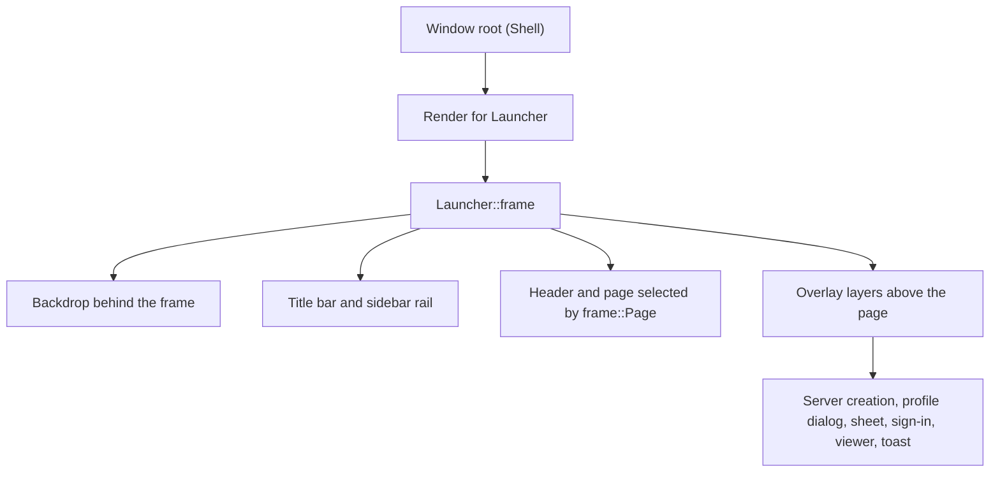
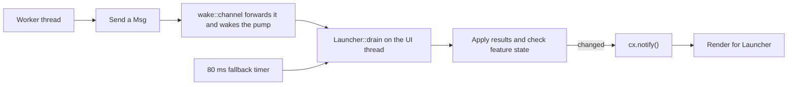

# Launcher architecture

The Sunrise launcher installs and updates Sunrise builds, prepares their game resources, and starts the client or a dedicated server. It also manages instances, mods, worlds, and accounts. The desktop window uses GPUI Fast. The window, CLI, and MCP server share the core in [`src/backend.rs`](../src/backend.rs) and the domain modules exposed by [`src/lib.rs`](../src/lib.rs). See the [README](../README.md) for player-facing behavior and [CONTRIBUTING.md](../CONTRIBUTING.md) for contribution rules and the history of the copied crates.

## Code map

### Files directly under `src/`

Names in this table are relative to [`src/`](../src/). The binary and the shared library declare their modules separately in `main.rs` and `lib.rs`.

| Area | Files | What they do |
| --- | --- | --- |
| UI shell | `main.rs`, `startup.rs`, `window_root.rs`, `launcher_render.rs`, `frame.rs` | Define the launcher entity, dispatch startup, and assemble the desktop frame. |
| UI shell | `rail.rs`, `shell.rs`, `titlebar.rs`, `status_strip.rs`, `command_search.rs` | Supply navigation, window chrome, Play status, and search shortcuts. |
| UI pages | `home.rs`, `home_mods.rs`, `instances_page.rs`, `instance_mods.rs`, `instance_icons.rs`, `glass_instance.rs`, `profile_dialog.rs`, `launch_page.rs` | Show Home and the selected profile, manage profile dialogs and icons, and edit per-instance launch options. |
| UI pages | `worlds_page.rs`, `datapacks_page.rs`, `packs_page.rs`, `screenshots_page.rs`, `console_page.rs` | Display an instance's worlds, packs, screenshots, and game output. |
| UI pages | `settings.rs`, `blocks_settings.rs`, `location_page.rs`, `glass_storage.rs`, `themes_page.rs`, `language_page.rs`, `collection.rs` | Draw settings, storage and relocation controls, appearance, language, and data collection. |
| UI pages | `glass_versions.rs`, `glass_sheet.rs`, `glass_toast.rs`, `sheets.rs`, `setup_page.rs` | Draw versions, instance settings, toasts, shared dialogs, and Windows setup. |
| Backend | `lib.rs`, `backend.rs`, `launcher_setup.rs`, `launcher_messages.rs`, `launcher_play.rs`, `wake.rs` | Connect shared operations to the desktop's startup, task handlers, and message pump. |
| Backend | `github.rs`, `nightly.rs`, `signed.rs`, `build_import.rs`, `developer_install.rs` | Discover releases, verify downloads, and install imported or checkout builds. |
| Backend | `downloads.rs`, `download_retry.rs`, `mojang.rs`, `mojang_tests.rs`, `sources.rs`, `sources_tests.rs`, `preparer.rs`, `java.rs`, `jdk.rs` | Find or fetch Minecraft files and Java, run the preparer, and test the file and download paths. |
| Backend | `launch.rs`, `launch_state.rs`, `process.rs`, `run_leases.rs`, `game_app.rs`, `windows_runtime.rs`, `developer_offline.rs`, `developer_play.rs`, `while_playing.rs` | Assemble and supervise game launches, manage platform-specific execution, and surface launch state. |
| Backend | `installer.rs`, `setup_args.rs`, `uninstall_aside.rs`, `update_handoff.rs`, `update_recovery.rs`, `mac_update.rs`, `notices.rs` | Handle launcher setup, removal, self-update, and bundled notices. |
| Backend | `identity.rs`, `data_location.rs`, `relocation.rs`, `carry_over.rs`, `storage.rs`, `cache_cleanup.rs` | Resolve data roots, migrate or move data, and inventory and reclaim managed storage. |
| Backend | `instances.rs`, `import.rs`, `export.rs`, `worlds.rs`, `datapacks.rs`, `packs.rs`, `screenshots.rs`, `shortcut.rs` | Manage instance files, sharing, worlds, packs, screenshots, and desktop launch shortcuts. |
| Accounts | `account.rs`, `account_chip.rs`, `owner_page.rs`, `switch_page.rs`, `microsoft.rs`, `profile_heads.rs`, `private_window.rs` | Handle Microsoft sign-in, ownership, account selection and artwork, and browser handoff. |
| Mods | `browser.rs`, `mods.rs`, `mods_page.rs`, `mods_project.rs`, `mod_icons.rs`, `github_mods.rs`, `github_mods_page.rs` | Provide registry and pack discovery, installation, project details and pictures, and the GitHub mod flow. |
| Mods | `native_mods.rs`, `native_cache.rs`, `native_fit.rs`, `native_status.rs`, `rust_toolchain.rs`, `native_build.rs`, `native_log_page.rs`, `build.rs`, `build_mode.rs`, `native_consent.rs` | Build and track native mods, manage the toolchain and cache, and show compatibility, consent, and progress. |
| Mods | `jars.rs`, `jar_launch.rs`, `jars_tests.rs` | Resolve mods' original Java asset and data jars, including the launch consent bridge and tests. |
| Servers | `servers.rs`, `servers_page.rs`, `glass_servers.rs`, `glass_server_dialog.rs`, `servers_format.rs`, `heads.rs` | Drive the dedicated server and draw its hosting controls, status, and player heads. |
| Servers | `join.rs`, `server_list.rs`, `multiplayer_page.rs`, `internet.rs`, `tailscale.rs` | Join and manage saved servers and show Tailscale sharing controls. |
| Rendering and motion | `backdrop.rs`, `blocks.rs`, `cat.rs`, `glass_ui.rs`, `widgets.rs`, `plate.rs`, `motion.rs`, `paint.rs`, `tokens.rs`, `theme.rs` | Draw scenery and controls and apply the palette, metrics, and motion curves. |
| Rendering and motion | `appearance.rs`, `themes.rs`, `theme_files.rs`, `picture_cache.rs`, `pictures.rs`, `perf.rs` | Resolve themes and background art, manage decoded pictures, and measure the window. |
| CLI and MCP | `cli.rs`, `cli_tools.rs`, `cli_catalog_tests.rs`, `cli_native_permission.rs`, `console.rs`, `mcp.rs`, `game_tools.rs` | Parse and run commands, attach terminal streams, generate MCP tools, and bridge to game control. |
| Utilities | `code_box.rs`, `cull.rs`, `line_edit.rs`, `markdown.rs`, `scrollbar.rs`, `selectable.rs`, `slider.rs`, `sticky.rs` | Supply reusable text, list, and input behavior. |
| Utilities | `i18n.rs`, `net.rs`, `proxy.rs`, `desktop.rs`, `desktop_seams.rs`, `zip_intake.rs`, `test_support.rs` | Provide translation, network and desktop helpers, ZIP intake, and test support. |
| Utilities | `bug_report.rs`, `game_log.rs`, `telemetry.rs`, `no_ai.rs` | Handle reports, game logs, telemetry, and the shared No AI setting. |

### Module directories under `src/`

| Directories | What lives there |
| --- | --- |
| `src/account/` | Session status and account tests. |
| `src/backend/` | Installation, release assets and selection, update selection, settings helpers, Play logging, and message types. |
| `src/browser/`, `src/browser/installed/`, `src/browser/sunrise/`, `src/browser/sunrise/auto/` | Source-specific browser operations, installed-pack tests, Sunrise dependency and pack handling, and registry auto-update tests. |
| `src/cli/` | Developer build commands, progress, settings JSON output, and storage tests. |
| `src/internet/`, `src/servers/`, `src/servers_page/` | Hosting share UI, remote server control and tests, and hosting page composition. |
| `src/jars/`, `src/zip_intake/` | Jar download and launch preparation, and the ZIP intake source adapter and tests. |
| `src/mods/`, `src/mods/data_packs/`, `src/mods/model/`, `src/mods/pack_discover/`, `src/mods_page/` | Mods UI and state, pack discovery, and tests for these paths. |
| `src/native_mods/`, `src/native_mods/bundle/`, `src/native_mods/mixins/`, `src/native_mods/workspace/`, `src/native_mods/tests/` | Native build planning, SDK cache, bundle packaging, mixin support, and build and runtime tests. |
| `src/process/`, `src/process/leases/`, `src/process/leases/tests/`, `src/process/supervisor/`, `src/run_leases/` | Child process ownership and supervision, launch and tree locks, and platform tests. |
| `src/settings/`, `src/sheets/` | Appearance controls and the version chooser. |
| `src/storage/`, `src/theme_files/`, `src/theme_files/fixtures/` | Storage inventory and eviction. Theme file tests and their image fixture. |
| `src/appearance/`, `src/cache_cleanup/`, `src/data_location/`, `src/downloads/`, `src/github/`, `src/github_mods/`, `src/i18n/`, `src/java/`, `src/launch/`, `src/launch_state/`, `src/mac_update/`, `src/native_cache/`, `src/relocation/`, `src/shortcut/`, `src/themes/` | Tests alongside their matching infrastructure modules. |
| `src/datapacks/`, `src/export/`, `src/game_log/`, `src/home/`, `src/import/`, `src/instances/`, `src/join/`, `src/packs/`, `src/server_list/`, `src/tailscale/`, `src/worlds/` | Tests alongside their matching feature modules. |

### Scenery, shared crates, and tools

| Directories | What lives there |
| --- | --- |
| `scenery/`, `scenery/src/` | Pixel-art drawing, skies, the coast, rain, panel surfaces, and the scenery clock. |
| `crates/addresses/`, `crates/addresses/src/` | Built-in service addresses. |
| `crates/bench/`, `crates/bench/src/` | Benchmark report format and measurement helpers. |
| `crates/friends/`, `crates/friends/src/` | Sunrise invite code parsing. |
| `crates/mcp/`, `crates/mcp/src/` | Shared MCP protocol and stdio transport. |
| `crates/nbt/`, `crates/nbt/src/` | Java Edition NBT used for files such as `level.dat` and `servers.dat`. |
| `crates/release-verify/`, `crates/release-verify/src/`, `crates/release-verify/src/bin/`, `crates/release-verify/keys/` | Release signature verification, trust keys, and the signing utility. |
| `crates/release-verify/tests/`, `crates/release-verify/tests/signed/`, `crates/release-verify/tests/signed/native-build/`, `crates/release-verify/tests/signed/nightly/`, `crates/release-verify/tests/signed/release/`, `crates/release-verify/tests/signed/sdk/`, `crates/release-verify/tests/signed/snapshot/` | Release signing and verification tests and channel-specific fixtures. |
| `crates/resolver/`, `crates/resolver/src/` | Minecraft server SRV resolution. |
| `crates/sdk/`, `crates/sdk/src/`, `crates/sdk/src/sdk/` | Signed SDK index and verified SDK slice unpacking. |
| `crates/shader-api/`, `crates/shader-api/src/` | Sunrise shader pack format and validation. |
| `crates/smod/`, `crates/smod/src/`, `crates/smod/src/dependencies/`, `crates/smod/src/manifest/`, `crates/smod/src/selection/` | Mod packages and manifests, dependency notices, and selection context. |
| `crates/smod/src/index/`, `crates/smod/src/index/browser_state/` | Registry lookup and resolution, installed browser state, and file ownership claims. |
| `crates/smod/src/holder/`, `crates/smod/src/holder/record/`, `crates/smod/src/holder/record/gc/`, `crates/smod/src/runtime_leases/`, `crates/smod/src/runtime_leases/cleanup/` | Game-run holders, records, and cleanup for shared runtime files. |
| `crates/smod/src/install_lock/`, `crates/smod/src/local_control/`, `crates/smod/src/output/` | Install locking tests, platform control transports, and process output capture. |
| `crates/smod/examples/`, `crates/smod/examples/holder_actor/`, `crates/smod/tests/`, `crates/smod/tests/index/`, `crates/smod/tests/registry-resolution/` | Holder actor fixture and mod package and registry tests. |
| `crates/system/`, `crates/system/src/` | Machine and OS probes. |
| `crates/telemetry/`, `crates/telemetry/src/`, `crates/telemetry/tests/` | Consent, payloads, outbox, upload, and tests. |
| `crates/theme/`, `crates/theme/src/`, `crates/theme/fonts/`, `crates/theme/icons/`, `crates/theme/icons/glass/`, `crates/theme/icons/pixel/` | Design tokens, fonts, and both icon sets. |
| `tools/` | Release and packaging helpers, language updates, test harnesses, and UI migration scripts. |
| `tools/ci/`, `tools/tests/` | CI pins, setup and release helpers, manual-test inventory, and Python tests for the tooling. |
| `tools/lang_review/`, `tools/lang_review/launcher/` | Translation review files. The runtime catalogs are under [`lang/`](../lang/). |

## How a frame is built

[`src/startup.rs`](../src/startup.rs) opens the window. The root `Shell` holds a cached `Launcher` entity, so GPUI Fast can reuse its rendered view between invalidations. [`src/window_root.rs`](../src/window_root.rs).

`Launcher::frame` sets the motion preference, viewport sizing, paint palette, and focus before it builds the rail, header, and page. The ordinary modal layers are appended in order and the last present one gets modal handling. The viewer and toast are appended above those layers. [`src/launcher_render.rs`](../src/launcher_render.rs), [`src/frame.rs`](../src/frame.rs).

GPUI's `with_animation` advances an element and schedules another frame while the animation is active. A continuously drawn view can call `request_animation_frame` directly, as the scenery crate's rain view does. GPUI notifies the view that requested the frame. An animation inside the launcher's own view redraws the whole `Launcher` view on each step. A separate view can invalidate itself and keep the launcher view cached. The main frame's backdrop is currently still. [`src/motion.rs`](../src/motion.rs), [`scenery/src/rain.rs`](../scenery/src/rain.rs), [`src/backdrop.rs`](../src/backdrop.rs).

## How workers update the window

For example, the startup release worker sends `Msg::Releases`. The setup code runs the pump when `wake::woken` resolves or the 80 ms timer fires. An 8 ms pause after each drain batches bursts such as progress and process output. The periodic tick also handles time-based work such as toast expiry. If the forwarding thread fails to start, the channel still delivers messages for the timer to pick up. [`src/launcher_setup.rs`](../src/launcher_setup.rs), [`src/wake.rs`](../src/wake.rs).

`Launcher::drain` uses `try_recv` to take queued messages without blocking. It applies results to launcher state, for example recording the release list as ready or failed. It also checks feature state. The artwork loader, for example, records its results in a shared queue and wakes the pump directly. The drain calls `cx.notify()` if anything changed. [`src/launcher_messages.rs`](../src/launcher_messages.rs), [`src/backend/messages.rs`](../src/backend/messages.rs), [`src/instance_icons.rs`](../src/instance_icons.rs).

## State and data

| What | Where and why |
| --- | --- |
| Roots | `backend::data_dir` uses a nonempty `SUNRISE_LAUNCHER_HOME` first, then the configured relocation root, then `sunrise/launcher` under the platform data directory. `backend::game_home` resolves the separate game root with `SUNRISE_HOME` and defaults to `sunrise/game` under platform data. The default relocation pointer is `sunrise/location/location.json` under platform config. `SUNRISE_LAUNCHER_LOCATION_FILE` can override the pointer. [Backend](../src/backend.rs), [identity](../src/identity.rs), [location resolution](../src/data_location.rs). |
| Settings and profile data | Shared `Settings` loads and saves `settings.json` under the launcher root. The window keeps a copy in `Launcher` and records save failures for retry. Instance metadata is in `instances.json`, with game files in the instance's game home. Account metadata is in `accounts.json`. See the README for credential storage. [Backend](../src/backend.rs), [window setup](../src/launcher_setup.rs), [instances](../src/instances.rs), [accounts](../src/account.rs). |
| Builds and caches | Installed game builds are under `versions/` in the launcher root. Release API responses live in `cache/github/`. Storage inventory and eviction define which managed files can be reclaimed, including disposable native build outputs. [Backend](../src/backend.rs), [GitHub cache](../src/github.rs), [storage](../src/storage.rs), [eviction](../src/storage/eviction.rs). |
| Image caches | The mod browser keeps resized network images on disk under `mod-browser/images/`. The instance art worker caches decoded icons by key and display size. The picture helpers provide fitted decoding and a byte-budgeted LRU for local images. `picture_cache.rs` tracks retired render images so their atlas allocations can be freed. [Browser images](../src/browser/images.rs), [instance artwork](../src/instance_icons.rs), [local pictures](../src/pictures.rs), [atlas cleanup](../src/picture_cache.rs). |
| Logs | Session measurements go to `benchmarks/launcher-<time>-session.json` under the launcher root. The `benchmark` command writes its aggregate report under `benchmarks/` too. Game logs and crash reports live in the game home. [Performance code](../src/perf.rs), [README performance log](../README.md#performance-log), [README game logs](../README.md#logs-and-crash-reports). |

## Cross-cutting rules

- **Translations.** Use `tr` for labels and `trf` for messages with named substitutions. The source English text is the lookup key and fallback for the catalogs in `lang/*.json`. Pass each new key to `tools/launcher_add_lang_keys.py` to seed the catalogs while preserving existing translations. [Translation code](../src/i18n.rs), [catalogs](../lang/), [catalog helper](../tools/launcher_add_lang_keys.py).
- **Reduced motion.** Use `motion::eased` for element easing and check `motion::still` before requesting frames for decorative motion. The frame passes the resolved preference to GPUI. The scenery clock resolves the settings, system preference, and diagnostic overrides. Reduced graphics takes precedence and holds motion still. [Motion helpers](../src/motion.rs), [frame](../src/frame.rs), [scenery clock](../scenery/src/clock.rs).
- **Theme tokens.** Start with `crates/theme` for shared typography, icons, sizes, and curves. UI modules use the launcher adapters and named paint roles for colors. [Shared theme](../crates/theme/), [launcher tokens](../src/tokens.rs), [theme adapter](../src/theme.rs), [paint roles](../src/paint.rs).
- **Frame pacing.** `WindowOptions` in startup keeps GPUI Fast's default inactive interval of about 33 ms, except in benchmark mode. GPUI Fast also has a separate low-power interval. Disabling the inactive interval for benchmarks keeps an unfocused benchmark window from measuring that cap. Check focus and the power profile before comparing animation timing. [Window setup](../src/startup.rs), [dependency pin](../Cargo.lock).

## CLI and MCP

[`src/cli.rs`](../src/cli.rs) defines subcommands and arguments with clap and dispatches to the shared operations. [`src/cli_tools.rs`](../src/cli_tools.rs) walks the same command tree to generate tool names and input schemas for eligible leaf commands. For example, `mods search` becomes `mods_search`. A generated tool converts arguments back to CLI words, runs the current executable with `--json`, and returns its output. Commands marked destructive require `confirm: true`.

[`src/mcp.rs`](../src/mcp.rs) combines the generated catalog with session tools. Play, server control, and account sign-in can keep a process or operation alive between calls in that session. The protocol and stdio transport come from [`crates/mcp/`](../crates/mcp/). The generated [command reference](launcher-commands.md) describes the supported calls.

## Testing

- **Unit tests** live with their modules, either inline or in child test modules. The full CI matrix runs `cargo test --locked --workspace --lib --bins`.
- **Integration tests** under `tests/` exercise library behavior or the built launcher. For example, `tests/owner_gate.rs` drives CLI and MCP subprocesses. The Windows CI matrix runs `developer_install` and `storage_consent` separately as non-process integration targets. [Integration tests](../tests/), [owner gate](../tests/owner_gate.rs).
- **Ignored tests** include cases that need a desktop, network, keychain, or fixture subprocess. Check the inventory before running them. The daily workflow uses it to skip manual cases and runs a separate set of Windows process tests. [Manual-test inventory](../tools/ci/manual-tests.txt), [daily workflow](../.github/workflows/daily.yml).
- **CI** runs formatting and the pinned game-copy comparison on every PR. Full checks run Clippy and unit tests on Linux, macOS, and Windows, with Linux doctests and Python tooling tests and release signing tests on Linux and macOS. Fork PRs get full checks through a maintainer dispatch. The workflow sets scratch roots and disables self-update and telemetry. [CI workflow](../.github/workflows/ci.yml), [Rust pin](../tools/ci/rust-version), [game-copy policy](../CONTRIBUTING.md#copies-of-game-files).

## Where to start

| Task | First files to open |
| --- | --- |
| Add a setting | Define the persisted field and default in [`src/backend.rs`](../src/backend.rs). Add its row in [`src/settings.rs`](../src/settings.rs) or [`src/settings/appearance.rs`](../src/settings/appearance.rs) and follow the save path in [`src/launcher_setup.rs`](../src/launcher_setup.rs). If exposed in the CLI, update the setter and help in [`src/cli.rs`](../src/cli.rs) and check the [JSON output](../src/cli/settings_output.rs). |
| Add a page | Declare its module in [`src/main.rs`](../src/main.rs). Add the visible route to `frame::Page`, page dispatch, and navigation in [`src/frame.rs`](../src/frame.rs). Follow the relevant entry point in the header or [`src/rail.rs`](../src/rail.rs). |
| Add a CLI command | Start with the clap definition and dispatch in [`src/cli.rs`](../src/cli.rs) and put shared behavior in the owning library module. Check how [`src/cli_tools.rs`](../src/cli_tools.rs) exposes the command and regenerate the [command reference](launcher-commands.md) with `SUNRISE_WRITE_DOCS=1 cargo test --locked --bin sunrise-launcher the_launcher_reference_is_up_to_date`. |
| Change an animation | Find the view or element doing the drawing, then check its curve in [`src/motion.rs`](../src/motion.rs) or [`crates/theme/`](../crates/theme/). Verify the end state under reduced motion and check which view gets invalidated. |
| Add a translated string | Write the English key at the call site with `tr` or `trf`, seed it with [`tools/launcher_add_lang_keys.py`](../tools/launcher_add_lang_keys.py), and keep named placeholders consistent in [`lang/`](../lang/). |

## Known rough edges

- Two page enums coexist. The frame reads `self.ui.page` using `frame::Page`. Benchmark page changes call `Launcher::go`, which writes the separate `self.page` field. Follow the frame's route for visible navigation. [Frame](../src/frame.rs), [binary state](../src/main.rs), [setup](../src/launcher_setup.rs), [benchmark dispatch](../src/launcher_messages.rs).
- Some README paths describe older layouts. The data-move section and the Sunrise builds section give different location pointer directories. The fallback roots and pointer in this guide follow the current identity and path resolution code. [README](../README.md), [identity](../src/identity.rs), [location resolution](../src/data_location.rs).
- The backend entry point still contains release orchestration, resource preparation, game launch, and settings alongside its extracted helper modules. Shared behavior is easier to find if you start with the operation's caller, then follow it into the owning module. [Backend](../src/backend.rs), [backend helpers](../src/backend/).
